# SharpMind System Documentation

Membership Management and Transaction Processing System  
Verified November 24, 2026, Asia/Manila

SharpMind gives an administrator a workspace for managing members, categories, levels, applications, renewals, payments, and membership status. This guide covers the implementation, database design, daily use, notifications, verification, screenshots, and a demonstration aligned with the supplied 100-point rubric.

Members are managed records and email recipients. Administrators sign in through Laravel session authentication. Member self-service accounts and payment-gateway checkout are outside this project's scope.

## Contents

- [Requirements and implementation](#requirements-and-implementation)
- [Membership catalogue](#membership-catalogue)
- [Installation and operation](#installation-and-operation)
- [Database design](#database-design)
- [Administrator user guide](#administrator-user-guide)
- [Transaction and membership lifecycle](#transaction-and-membership-lifecycle)
- [Validation and code organization](#validation-and-code-organization)
- [Notifications and scheduled work](#notifications-and-scheduled-work)
- [Screenshots](#screenshots)
- [Demonstration guide](#demonstration-guide)
- [Verification and rubric evidence](#verification-and-rubric-evidence)
- [Maintenance and troubleshooting](#maintenance-and-troubleshooting)

## Requirements and implementation

| Supplied requirement | Implementation and evidence |
| --- | --- |
| Add, view, edit, delete/deactivate members | `MemberController` resource actions and registration, profile, edit, list views; edit status to Inactive or confirm permanent deletion. |
| Search by name, category, level | Name/email/number search plus category and level filters; pagination retains filters. |
| One category and one level per member | Required validated foreign keys and Eloquent relationships. |
| Unique membership number | `MEM-YYYY-XXXXX` with database uniqueness, collision retries, and validation feedback. |
| Student, Regular, Senior Citizen, Corporate | Default catalogue seeder and category CRUD through cards/editor dialogs. |
| Basic, Silver, Gold, Platinum | Default seeder and level CRUD including fee, validity, and individual benefits. |
| Application and renewal transactions | Transaction form with member, purchased level, and Application/Renewal type. |
| Payment linked to valid transaction | Payment validation and row locking; unique transaction foreign key allows one payment per purchase. |
| Official transaction/reference number | Unique `TRX-YYYY-XXXXX` and `PAY-YYYY-XXXXX` system references. These do not constitute tax-authority invoice certification. |
| Pending, Paid, Approved, Expired, Cancelled | Server-side transitions, status badges, detail actions, and automatic expiry. |
| Only paid purchases approved | Requires Paid status and recorded payment covering the amount due. |
| Member transaction history/payment details | Profile history links to receipts with purchased terms and payment reference, method, date, amount. |
| MySQL, migrations, Eloquent | Required tables, foreign keys, model relationships; isolated native MySQL verification. |
| Required controllers | `MemberController`, `CategoryController`, `LevelController`, `TransactionController`, `PaymentController`. |
| Blade forms, lists, details, dashboard | Login, dashboard, member CRUD, catalogues, transactions, payment form, member history, printable receipt. |
| Laravel validation/authentication | Form requests/controller validation, Auth/session guard, hashed passwords, protected routes, CSRF. |
| Documentation/presentation | README, this guide, ERD/data dictionary, rubric matrix, eleven screenshots, demonstration steps. |

Paths in this guide are relative to the project root. [README.md](README.md) contains the installation commands.

## Membership catalogue

`MembershipCatalogueSeeder` creates defaults using `firstOrCreate`. Re-running it fills missing names without overwriting existing administrator edits.

| Category | Default discount |
| --- | ---: |
| Student | 20% |
| Regular | 0% |
| Senior Citizen | 20% |
| Corporate | 0% |

These percentages are configurable project defaults.

| Level | Fee | Validity | Benefits |
| --- | ---: | ---: | --- |
| Basic | ₱500.00 | 30 days | Introductory courses; community forums; downloadable study guides |
| Silver | ₱1,200.00 | 90 days | Core courses; quizzes; priority instructor Q&A |
| Gold | ₱2,500.00 | 180 days | All courses; digital certificates; live monthly webinars |
| Platinum | ₱5,000.00 | 365 days | All-inclusive courses; certificates; 1-on-1 mentoring; exclusive workshops |

The summary displays original fee, category discount, amount due, validity, and individually boxed benefits. Student + Basic is **₱500.00 − ₱100.00 (20%) = ₱400.00**.

## Installation and operation

Follow the [fresh installation instructions](README.md#fresh-installation): install locked dependencies, configure MySQL, generate a fresh application key, migrate/seed, create an administrator, build assets, and start the development processes.

Verified versions are PHP 8.2, Laravel 12.70.2, Pest 3.8.7, and Vite 7.3.7. Vite requires Node 20.19+ or 22.12+. No additional dependencies were introduced for these fixes.

`php artisan app:create-admin` securely prompts for a name, unique email, and confirmed password of at least 12 characters. It does not replace existing accounts. Normal seeding provides catalogue data without a shared administrator login.

`composer run dev` starts the application, queue listener, scheduler, and Vite. For hosting, keep a persistent queue worker running and invoke Laravel scheduling every minute through the host scheduler/cron. Set `APP_DEBUG=false` outside local development and protect environment secrets.

### Optional fictional demonstration data

Use a separate empty disposable database. In that local configuration set:

```dotenv
APP_ENV=local
DEMO_MODE=true
MAIL_MAILER=log
```

Point `DB_DATABASE` at the demonstration database, then run:

```powershell
php artisan config:clear --no-interaction
php artisan migrate --seed --no-interaction
php artisan db:seed --class=DemonstrationSeeder --no-interaction
```

Sample login: **admin@sharpmind.test** / **SharpMindDemo2026!**. Only the optional demonstration seeder creates this known account.

The fictional dataset contains Avery Santos, Jordan Reyes, Morgan Lim, Taylor Cruz, and Casey Villanueva, seven transactions spanning all five statuses, and four payments. Dates are relative to seeding. Re-running the seeder does not duplicate its named records. It dispatches no notifications, requires the demo switch, and refuses production environments.

Use these known credentials only in a private disposable demonstration environment. For real operation, select the normal database and keep `DEMO_MODE=false`.

## Database design

### Entity relationship diagram

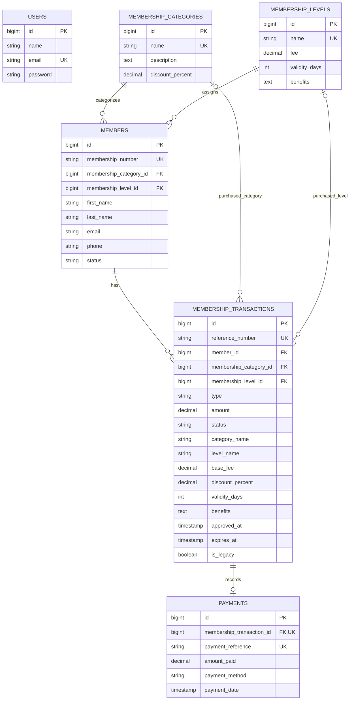

Administrator `users` are independent of member records. Laravel also maintains session, password-reset, cache, job, failed-job, and migration support tables.

### Data dictionary

| Table | Main data and constraints |
| --- | --- |
| `users` | Administrator name, unique login email, hashed password, remember token, timestamps. |
| `membership_categories` | Unique name, description, percentage discount. |
| `membership_levels` | Unique name, decimal fee, validity days, benefits. |
| `members` | Unique membership number; required category/level foreign keys; name, email, normalized phone/country, address components, coordinates, status. |
| `membership_transactions` | Unique reference; member FK; Application/Renewal type, amount/status; purchased category/level IDs and names, fee, discount, validity, benefits; approval/expiry timestamps, legacy marker. |
| `payments` | Unique payment reference and transaction FK; amount, method, date. |

Money uses fixed precision decimal columns. Foreign keys prevent orphaned members and invalid payment links. Contact uniqueness is validated; generated references also have database unique indexes.

### Historical purchase data

Catalogues define editable current offerings. Member foreign keys identify current assignment. Each transaction stores the terms purchased at that time. This intentional historical copy preserves category, level, fee, discount, benefits, validity, and dates when catalogue/member settings change.

Pending/Paid renewals do not apply their purchased assignment until approval. Receipts and queued transaction emails read their stored purchase terms.

### Deletion rules

Assigned categories/levels cannot be deleted. Catalogue entries used by Pending/Paid purchases also remain protected until those purchases are finished or cancelled. Controllers check inside database transactions; restrictive member foreign keys provide additional protection.

Unused catalogue entries with only closed transaction history may be removed. Historical catalogue IDs become null while stored names and terms remain.

Permanent member deletion cascades to that member's transactions and payments. Use **Edit → Inactive** or current membership cancellation to retain history. Permanent deletion requires confirmation in the interface.

### Older records and migration recovery

Older transactions did not store all original purchase terms or a dedicated approval timestamp. The migration backfills available details and marks those rows `is_legacy=true`, preserving recorded amounts, references, payments, and status. Their reconstructed terms/dates may need comparison with an original receipt; the receipt displays a historical warning. New purchases store explicit terms and dates.

All 14 current migrations are applied. Fresh installation, rollback, and reinstallation were tested separately, including native MySQL foreign key/index restoration.

## Administrator user guide

### Login and dashboard

Sign in with your administrator account. Dashboard cards show total members, active members, pending transactions, and collected payments. Recent transactions and membership distribution support the overview. Navigation opens Members, Transactions, Categories, and Levels.

### Member registration and management

Open **Members → Register member**. Complete name, email, phone country/number, address, category, and level. The country control defaults to a compact Philippines flag and +63.

The address uses Barangay/Village/District, City, State/Province, and ZIP code fields. **Find on map** uses their combined value. Pin placement updates coordinates; separate cards show coordinates/weather. Weather availability does not prevent registration.

Review fee/discount breakdown and individual benefits. Registration creates a Pending member and queues welcome mail. Create an Application transaction separately to collect payment and activate membership.

Search by name, email, or membership number and filter by category/level. The blue eye opens profiles, green pencil edits, and red delete icon opens confirmation. Use Inactive in the edit form to deactivate while retaining history.

Status badges show Active green, Pending blue, Inactive red. Levels have distinct colors with visible names. The member profile includes contact/membership data, expiry, benefits, and linked transaction history.

### Categories and levels

Add or edit using catalogue dialogs. Enter benefits on separate lines; cards and registration summaries show individual items. Changes affect future purchases while completed transaction terms remain fixed.

Delete an unused entry using the red control. Assigned entries or entries tied to open purchases return an explanation and remain intact.

### Applications, renewals, payments

Open **Transactions → New transaction**. Select a member, purchased level, and Application/Renewal. The server computes amount from the purchased level and member category. A unique TRX reference identifies the resulting Pending transaction.

On its detail page select **Record payment**, enter an amount covering the total and a method, then confirm. The purchase becomes Paid and gains a unique PAY reference. Duplicate payments are blocked.

On the Paid detail select **Approve**. The server rechecks payment, stores fixed dates, applies the purchased category/level, sets the member Active, and queues approval mail.

### History and printing

Open a profile history entry or transaction row. Receipts display reference/member, purchased terms, fee/discount, validity, approval/expiry when available, and payment details. The print control supports printing or saving as PDF; navigation and actions are excluded from printed output.

### Cancellation and deactivation

Cancellation appears on the **transaction detail page**, not as a Cancel button in every list row.

- Pending/Paid: **Cancel transaction** closes only that purchase; an existing active membership remains.
- Current Approved membership for an Active member: **Cancel membership** cancels that purchase and sets the member Inactive.
- An older Approved purchase cannot cancel a newer active renewal.
- Payment records remain after cancellation. Cancellation does not issue a refund.

For administrative deactivation without changing transactions, edit the member status to Inactive. Membership expiry is automatic; there is no manual Mark expired button.

## Transaction and membership lifecycle

| Event | Starting condition | Result |
| --- | --- | --- |
| Register | Valid member data and category/level | Member Pending; welcome queued |
| Create application/renewal | Valid member, purchased level/type | Purchase Pending with fixed terms |
| Record payment | Pending, no previous payment, sufficient amount | One payment; purchase Paid |
| Approve | Paid and sufficient recorded payment | Purchase Approved; member Active; purchased assignment and fixed dates |
| Cancel unapproved purchase | Pending/Paid | Purchase Cancelled; active membership retained |
| Cancel membership | Current Approved purchase, member Active | Purchase Cancelled; member Inactive; payment retained |
| Automatic expiry | Current Approved period reaches actual expiry | Purchase Expired; member Inactive; expiry mail queued |

The latest approval is ordered by `approved_at` and ID, rather than incidental later changes to `updated_at`.

Application expiry is approval plus purchased validity. Renewal expiry adds validity to the later of approval time or the current unexpired membership's expiry. Renewing 30 days with five days remaining yields 35 days of remaining access. Catalogue edits do not move stored expiry.

Checks run every minute. A nearing expiry triggers reminders; the membership expires only when its actual expiry is reached. Repeated expiry checks do not duplicate the change/email.

## Validation and code organization

### Validation

- Names, email, phone country/number, category, and level are required.
- Email format/uniqueness, duplicate full names, and normalized phone duplicates receive readable errors.
- Phone must match the selected calling code; Philippine numbers normalize to +63. Address lengths and coordinate ranges are checked.
- Referenced category/level IDs must exist; catalogue names must be unique.
- Monetary inputs accept at most two decimal places and fit the decimal column range. Payment must cover the amount due.
- Only valid transaction types/states are accepted; approval requires payment.
- Member/TRX/PAY references retry collisions up to five times, then return validation feedback. Database unique indexes remain authoritative.
- Fresh row locks and state checks reject duplicate or stale payments/approval attempts.

### MVC responsibilities

| Area | Main code |
| --- | --- |
| Members | `app/Http/Controllers/MemberController.php`, `app/Http/Requests/StoreMemberRequest.php`, `UpdateMemberRequest.php` |
| Catalogues | `CategoryController.php`, `LevelController.php` |
| Purchases and payments | `TransactionController.php`, `PaymentController.php` |
| Data/relationships | `app/Models/Member.php`, `MembershipTransaction.php`, `MembershipCategory.php`, `MembershipLevel.php`, `Payment.php` |
| References | `app/Models/Concerns/HasUniqueReference.php` |
| Shared email purchase data | `app/Notifications/MembershipEmailData.php` |
| Authentication and routing | `AuthController.php`, `routes/web.php` |
| Commands/schedule | `app/Console/Commands`, `routes/console.php` |
| Interface | `resources/views`, shared layouts/components, CSS/JavaScript |
| Database/test fixtures | `database/migrations`, `database/factories`, `database/seeders` |

Laravel Auth/session services and password hashing secure administrator login. Workspace routes require authentication. Forms use CSRF protection; Blade escapes member content. Controllers/Form Requests validate input; model fillable definitions constrain mass assignment.

## Notifications and scheduled work

Emails use SharpMind branding, readable colors, HTML, and plain text. Transaction notification data preserves purchase facts when queued.

| Notification class | Trigger and content |
| --- | --- |
| `MemberRegistered` | Registration welcome and member information |
| `MembershipTransactionSubmitted` | Application/Renewal reference, purchased terms, amount due, Pending status |
| `MembershipTransactionApproved` | Successful paid approval, membership/payment details, expiry |
| `MembershipExpiringReminder` | Current Active membership in its final seven days |
| `MembershipTransactionStatusUpdated` | Distinct transaction cancellation, membership cancellation, or automatic expiry message |

The last class supplies multiple status designs; five classes cover the events above. Notification dispatch is deferred until the database transaction commits. Transient delivery failures use bounded retries/backoff.

### Background operation

```powershell
php artisan queue:listen --tries=3 --timeout=60 --backoff=60 --no-interaction
php artisan schedule:work --no-interaction
```

Use separate terminals, or start them with `composer run dev`. The schedule runs `memberships:expire` every minute and `memberships:send-expiry-reminders` at **08:00 Asia/Manila** daily.

Reminders default to seven days (`--days=7`). They check exact expiry, current approval, Active status, and a daily cache marker. A stale queued reminder is skipped after renewal, expiry, deactivation, or changed expiry. Persistent database cache supports daily deduplication in normal operation.

Inspect scheduled work and failed jobs with:

```powershell
php artisan schedule:list --no-interaction
php artisan queue:failed --no-interaction
```

Commands that expire memberships or send reminders act on the configured database and recipients. Use tests/disposable data for demonstrations. Automated notification tests verify triggers, routing, content, and state; inbox delivery additionally depends on valid SMTP/provider settings. See [email configuration](README.md#email-setup).

## Screenshots

Actual application captures with fictional demonstration data, November 24, 2026. Newly seeded dates may differ.

### Login and dashboard


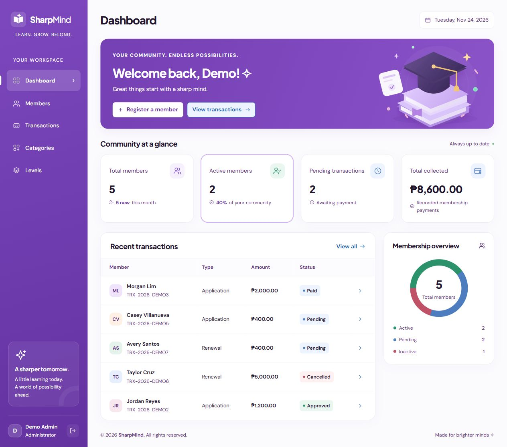

### Members

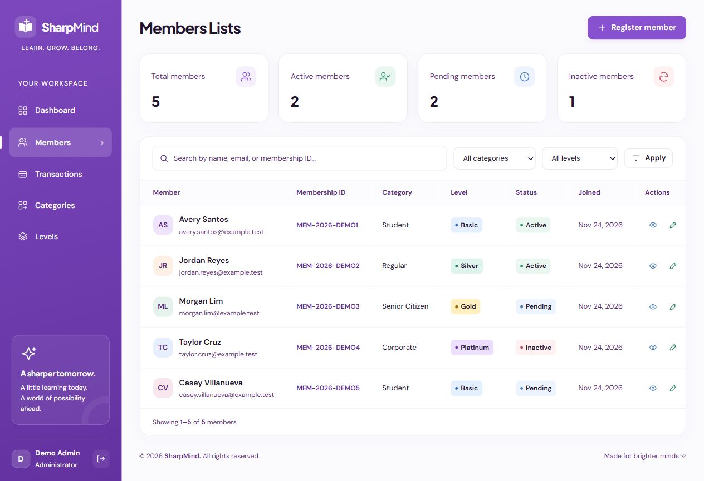

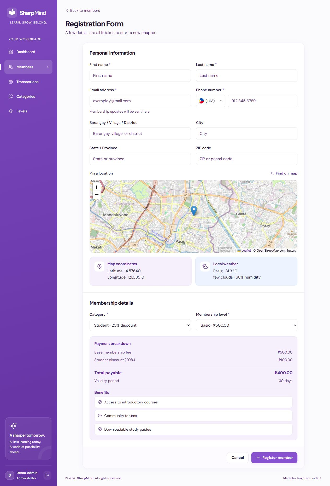

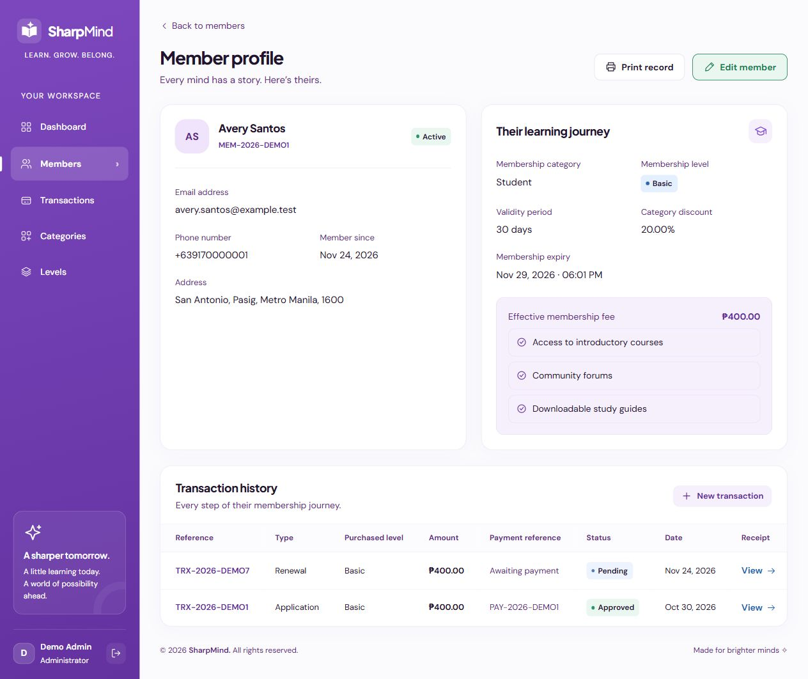

### Categories and levels

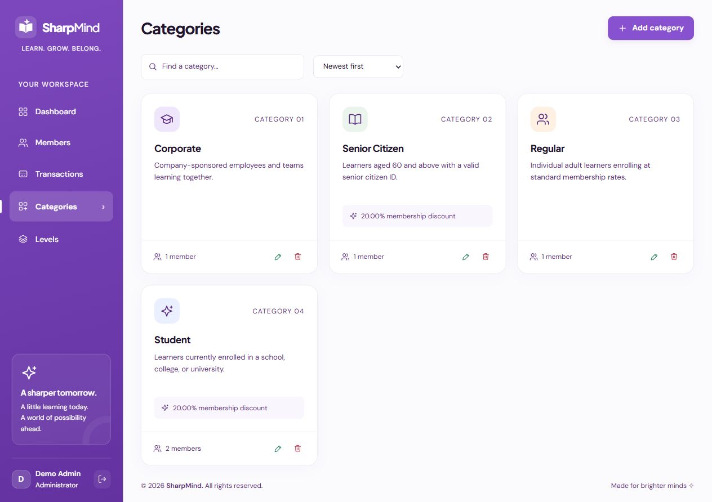

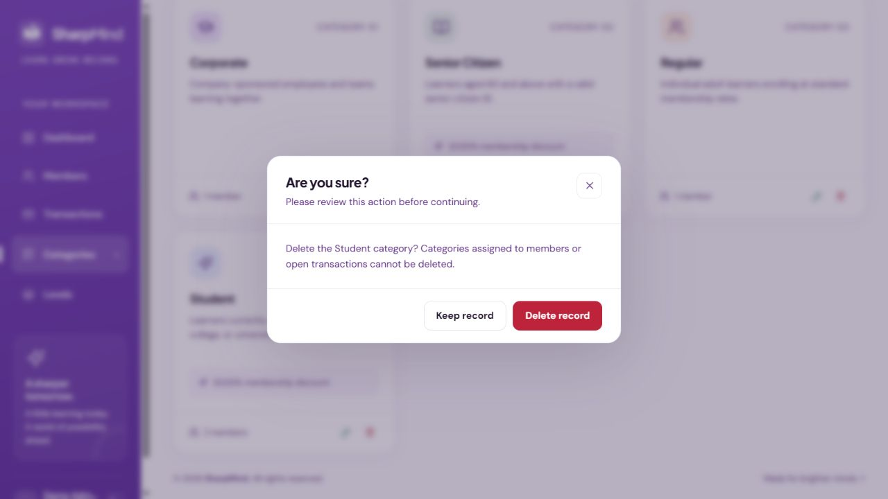

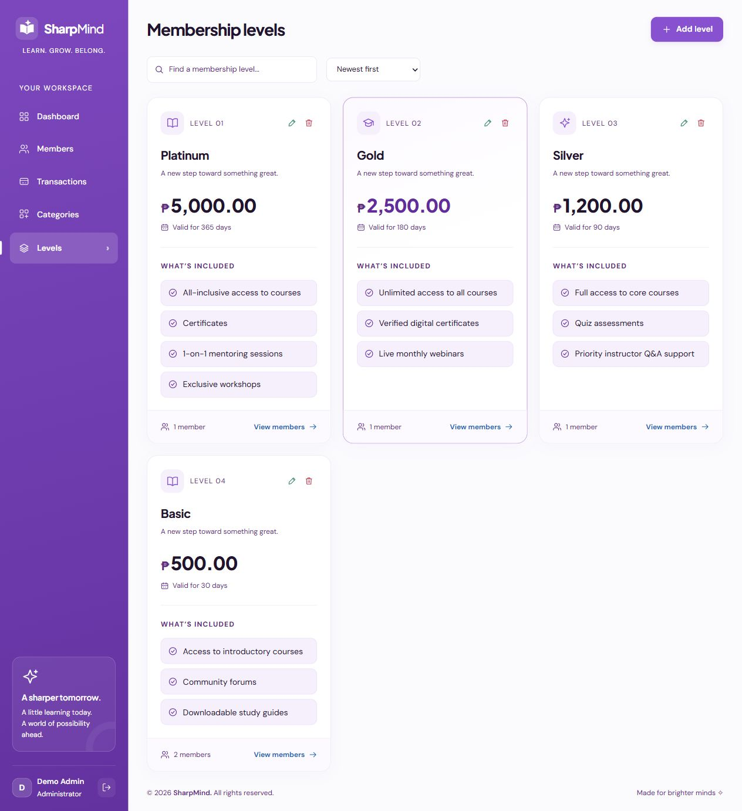

### Transactions and payment

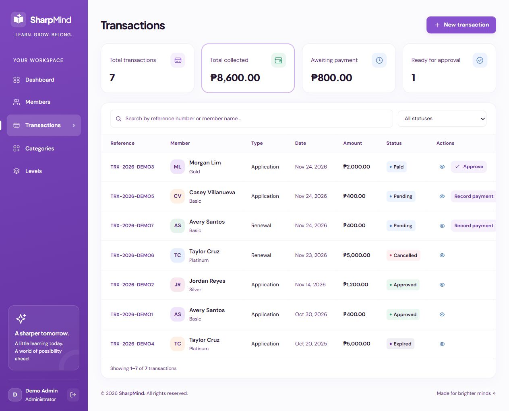

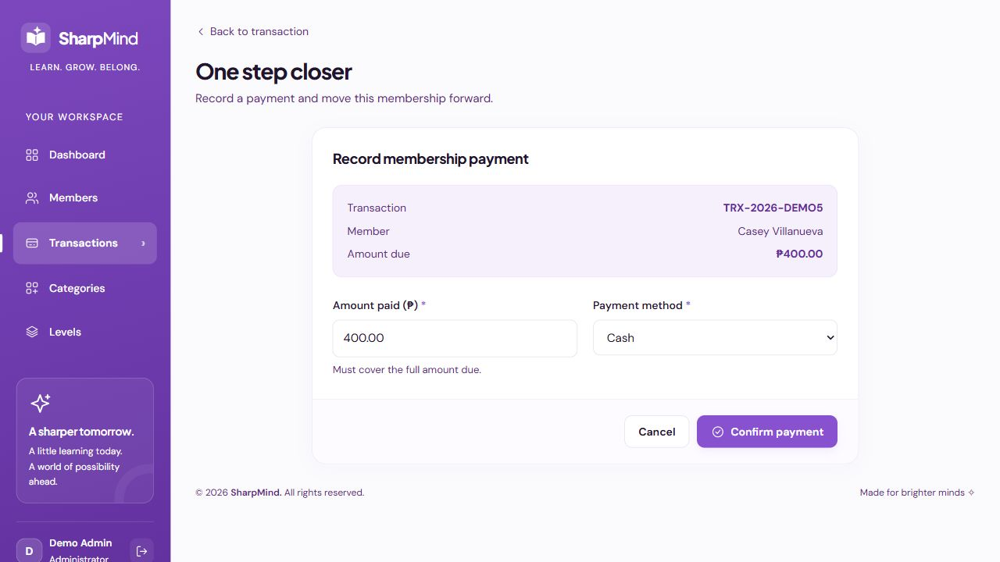

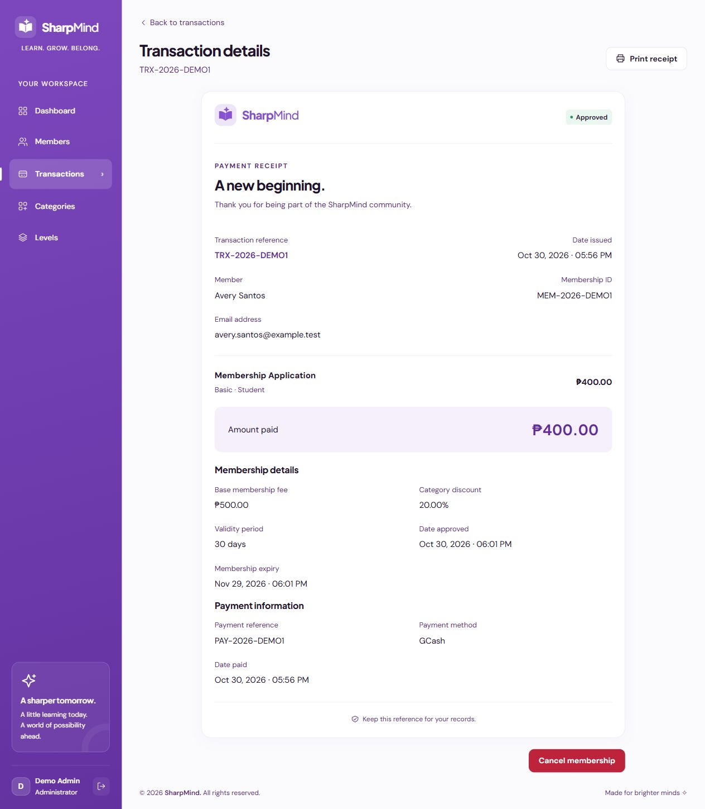

## Demonstration guide

Allow 10–15 minutes. Use a disposable demonstration database for edits/payments/cancellation and keep queue/scheduler running.

1. **Login/dashboard:** explain total/active members, pending transactions, collected payments, recent activity.
2. **Required catalogues:** show all categories/levels, discounts, fees, validity, individual benefits.
3. **Catalogue CRUD:** create an unused sample category/level, edit, delete; explain assignment/open-purchase protection.
4. **Registration:** register fictional contact data with Student + Basic; show ₱500 − ₱100 = ₱400, PH calling code, address/map, benefits. Use log mail unless the inbox is controlled by you.
5. **Validation/search/edit:** demonstrate invalid email or duplicate contact feedback, save valid data, find the member using search/filters, open/edit the profile.
6. **Application:** create an Application, show Pending status and unique TRX reference.
7. **Payment/approval:** record ₱400.00 Cash, show PAY reference/Paid, approve, show Active membership and fixed dates.
8. **History/printing:** open member history and receipt, explain payment/purchased terms, open print preview.
9. **Renewal:** create a Renewal; current assignment stays unchanged until paid/approved. Show extension carries remaining days.
10. **Cancellation:** explain transaction-only versus current membership cancellation using the detail page; payment history remains.
11. **Automation:** show `schedule:list` and safe automated tests below. Do not change real member dates or the computer clock.
12. **Usability/logout:** narrow the window to show responsive navigation/table scrolling, then sign out.

Safe expiry/reminder demonstration:

```powershell
php artisan test --compact tests/Feature/AutomaticMembershipExpiryTest.php tests/Feature/MembershipExpiryRemindersTest.php
```

These tests control time in isolated databases and fake outbound delivery. They exercise due-only expiry, reminder timing, stale job suppression, and duplicate prevention.

### Presentation checklist

- [x] Purpose and administrator workflow explained.
- [x] Required catalogue names/fees/validity/benefits seeded.
- [x] Member CRUD, search, filters, profiles, deactivation implemented.
- [x] Unique member/transaction/payment numbers enforced.
- [x] Application, renewal, payment, approval, cancellation, expiry covered.
- [x] History, payment details, printable receipt available.
- [x] ERD, data dictionary, migration recovery documented.
- [x] Email triggers, scheduler, queue, reminder/expiry behavior documented and tested.
- [x] Screenshots and repeatable presentation guide provided.

## Verification and rubric evidence

### Final verification

Tests run against isolated databases; real member records were not replaced with demonstration data.

| Check | Result |
| --- | --- |
| Complete suite with in-memory SQLite | 185 tests passing |
| Complete suite with native MySQL | 185 tests passing in a disposable database |
| Native MySQL migration rollback/reinstall regression | Passing, including FK/index restoration |
| Working database status | All 14 migrations applied |
| Frontend production build | Passing |
| PHP formatting | Laravel Pint applied |

Key automated evidence in `tests/Feature`:

| Test file | Coverage |
| --- | --- |
| `MemberContactTest.php` | Contact validation, country phones, addresses, duplicates |
| `MembershipPurchaseHistoryTest.php` | Fixed purchased terms/expiry, pending renewal behavior, early extension, receipt/history, approval rules |
| `CatalogueProtectionTest.php` | Catalogue CRUD, assignment/open-purchase guards, database protection, retained purchase history |
| `UniqueReferenceTest.php` | Member/TRX/PAY collision retries and validation |
| `InstallationReadinessTest.php` | Seeding, admin creation, implemented routes, backfill, migration reset/reinstall |
| `MembershipNotificationDeliveryTest.php` | Notification triggers, routing, queue behavior |
| `SharpMindEmailsTest.php` | Branded message rendering/content |
| `MembershipExpiryRemindersTest.php` | Reminder windows, daily deduplication, stale queued jobs |
| `AutomaticMembershipExpiryTest.php` | Due-only expiry, status, one expiry notification |
| `TransactionCancellationTest.php` | Pending/Paid/current Approved cancellation and protection of newer renewal |
| `MembershipBenefitsTest.php` | Individual benefit parsing/display |
| `SharpMindInterfaceTest.php` | Controls, readability/colors, receipts, requested interface behavior |

Repeat the full suite with `php artisan test --compact`. The committed test configuration uses SQLite `:memory:`, synchronous queues, array cache/session/mail. Native MySQL was also checked separately. When overriding test connection variables, select an empty disposable database: database tests rebuild their configured tables.

### Rubric mapping

| Criterion | Available | Evidence |
| --- | ---: | --- |
| Laravel setup/database connection | 15 | Working Laravel/MySQL, migrations, Eloquent, native database/rollback tests, setup guide |
| CRUD: Members | 20 | Create/read/update/delete, Inactive status, validation/search/filters, member tests/screenshots |
| Category/level management | 15 | Required defaults, full CRUD dialogs/cards, correct assignments, safe deletion |
| Transaction processing | 20 | Application/renewal, references, sufficient payment, approval, statuses, history, cancellation, automatic expiry, receipts |
| Database design | 10 | Required tables, foreign keys, unique indexes, decimal money, normalized catalogues plus historical purchase terms |
| Interface/usability | 10 | Responsive workspace, readable colors, feedback, maps, breakdowns, benefit boxes, printing, eleven screenshots |
| Code quality | 5 | MVC, form requests, reusable reference/email logic, typed relations, state checks, database transactions, Pint, tests |
| Documentation/presentation | 5 | README, system/user guide, ERD/dictionary, setup/email instructions, screenshots, demo/checklist |
| **Total available** | **100** | Evidence covers the supplied criteria; awarded marks remain the assessor's decision. |

## Maintenance and troubleshooting

| Symptom | Resolution |
| --- | --- |
| Database connection refused | Start MySQL; verify host/port/database/credentials; clear cached config. |
| Missing manifest or old styling | Install frontend dependencies if missing; run `npm run build` or keep Vite running. |
| Queued email not delivered | Keep queue listener running; inspect `queue:failed` and `storage/logs/laravel.log`. Correct configuration before retrying. |
| Gmail authentication failure | Check sender/app password and Google's account requirements. |
| No reminder/expiry | Keep scheduler running; inspect `schedule:list`. Reminder runs at 08:00 PHT in final seven days; expiry checks every minute at actual end time. |
| Map/weather unavailable | Check internet and optional `OPENWEATHER_KEY`; core registration remains usable. |
| Catalogue deletion refused | Reassign members and complete/cancel open purchases before deletion. |
| Older receipt warning | Check reconstructed terms/dates against original records; the old schema did not retain every purchase fact. |
| No login after fresh setup | Run `php artisan app:create-admin`; normal seeding has no default account. |

Back up before upgrades, apply forward migrations to real data, preserve the application key, secure environment credentials, and restart background processes after configuration changes. Destructive migration exercises belong only in disposable databases.

References: [Laravel migrations](https://laravel.com/docs/12.x/migrations), [Eloquent relationships](https://laravel.com/docs/12.x/eloquent-relationships), [seeding](https://laravel.com/docs/12.x/seeding), [notifications](https://laravel.com/docs/12.x/notifications), [scheduling](https://laravel.com/docs/12.x/scheduling).
