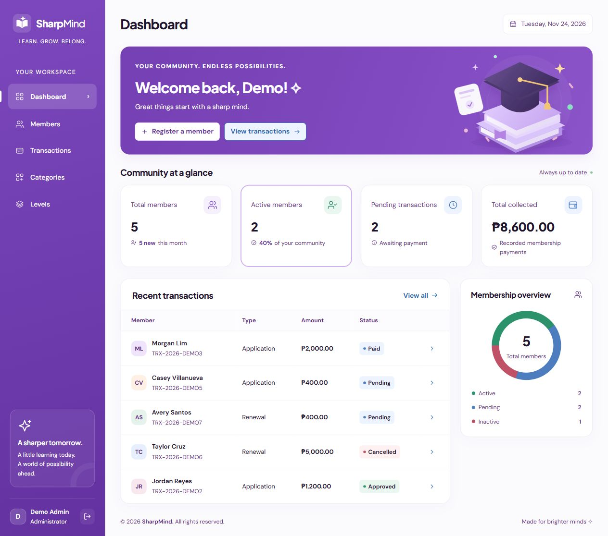

# SharpMind

Membership Management and Transaction Processing System built with Laravel 12, PHP 8.2, MySQL, Blade, and Vite.

The workspace supports member CRUD, category and level management, applications and renewals, payment recording, approval, cancellation, automatic expiry, email notifications, transaction history, and printable receipts.



[Technical documentation, database diagram, rubric evidence, and demonstration guide](PROJECT_DOCUMENTATION.md)

## Requirements

- PHP 8.2 with PDO MySQL, PDO SQLite for tests, Mbstring, OpenSSL, Fileinfo, Ctype, Tokenizer, and XML/DOM extensions.
- Composer 2, MySQL or compatible MariaDB, and Node.js 20.19+ or 22.12+ compatible with Vite 7.
- On XAMPP, start MySQL and make the XAMPP PHP executable available in your terminal.

Verified dependencies: Laravel 12.70.2, Pest 3.8.7, Vite 7.3.7. Install from the committed lock files.

## Fresh installation

Open PowerShell in the project directory. Copy the example environment only on a fresh installation; preserve an existing environment and application key.

```powershell
composer install
Copy-Item .env.example .env
php artisan key:generate --no-interaction
```

Create an empty MySQL database named `membership_system` using phpMyAdmin or your database administrator. Configure `.env`:

```dotenv
DB_CONNECTION=mysql
DB_HOST=127.0.0.1
DB_PORT=3306
DB_DATABASE=membership_system
DB_USERNAME=root
DB_PASSWORD=
```

These are local XAMPP examples. Use your actual database credentials.

```powershell
php artisan migrate --seed --no-interaction
php artisan app:create-admin
npm ci
npm run build
composer run dev
```

The administrator command asks for a name, a unique email, and a confirmed password of at least 12 characters. Password input is hidden. Normal seeding creates no default administrator.

`composer run dev` starts the application, queue listener, scheduler, and Vite. Keep it running for notifications and automatic expiry. Open the local address printed by the server.

Alternatively, use built assets and run each command below in its own terminal:

```powershell
php artisan serve --no-interaction
php artisan queue:listen --tries=3 --timeout=60 --backoff=60 --no-interaction
php artisan schedule:work --no-interaction
```

## Email setup

A fresh installation uses `MAIL_MAILER=log`: messages go to the application log instead of an inbox. The queue listener must still run.

For Gmail SMTP, replace these example values in `.env` with your sender account and app password:

```dotenv
MAIL_MAILER=smtp
MAIL_SCHEME=smtp
MAIL_HOST=smtp.gmail.com
MAIL_PORT=587
MAIL_USERNAME=your-sender@gmail.com
MAIL_PASSWORD="your-google-app-password"
MAIL_FROM_ADDRESS=your-sender@gmail.com
MAIL_FROM_NAME="SharpMind"
MEMBERSHIP_TIMEZONE=Asia/Manila
QUEUE_CONNECTION=database
CACHE_STORE=database
```

Google app passwords require 2-Step Verification and may be unavailable for some accounts. Follow [Google's instructions](https://support.google.com/accounts/answer/185833). Keep real passwords and `.env` out of version control.

After changes, run `php artisan config:clear --no-interaction` and restart development processes. If using `queue:work`, restart those workers too.

The scheduler checks actual membership expiry every minute and runs reminders at 08:00 Asia/Manila during the final seven days. Keep both the scheduler and queue running. See [notification operation and troubleshooting](PROJECT_DOCUMENTATION.md#notifications-and-scheduled-work).

Map tiles/address lookup need internet access. Weather also needs `OPENWEATHER_KEY`. Core registration does not require a weather response.

## Updating an existing installation

Back up MySQL, preserve `.env` and the application key, install locked dependencies, run `php artisan migrate --no-interaction`, and rebuild assets. Catalogue seeding adds missing defaults without overwriting administrator edits.

Do not use `migrate:fresh`, `migrate:reset`, or demonstration seeding against real records.

New transactions preserve purchased terms and fixed expiry dates. Older rows lacked some purchase details; the migration reconstructs available information and labels historical records. Their original level and approval date may need confirmation against the original receipt.

## Verification

```powershell
php artisan test --compact
php vendor/bin/pint --dirty --format agent
npm run build
```

The normal test configuration uses in-memory SQLite, synchronous queues, and an array mail transport; it does not send member emails. Native MySQL and migration rollback/reinstallation were also verified in a separate disposable database.

See the [verification record and rubric mapping](PROJECT_DOCUMENTATION.md#verification-and-rubric-evidence).

## Demonstration data

Normal seeding creates the four required categories and levels. Optional fictional data requires a local/testing environment and `DEMO_MODE=true`. Use only a separate disposable database. The [demonstration setup and guide](PROJECT_DOCUMENTATION.md#optional-fictional-demonstration-data) includes the sample account and presentation steps.

## Project layout

| Location | Purpose |
| --- | --- |
| `app/Models` | Relationships, historical purchases, unique references |
| `app/Http/Controllers` and `Requests` | Authentication, CRUD, validation, transactions, payments |
| `app/Notifications` and `resources/views/emails` | Branded HTML and plain text messages |
| `app/Console/Commands` and `routes/console.php` | Administrator creation, automatic expiry, reminders |
| `database/migrations`, `factories`, `seeders` | Schema and repeatable test/demo data |
| `resources/views`, `css`, `js` | Interface and printing |
| `tests/Feature` | Workflow, validation, database, notification, interface tests |
| `resources/screenshots` | User guide and presentation images |
